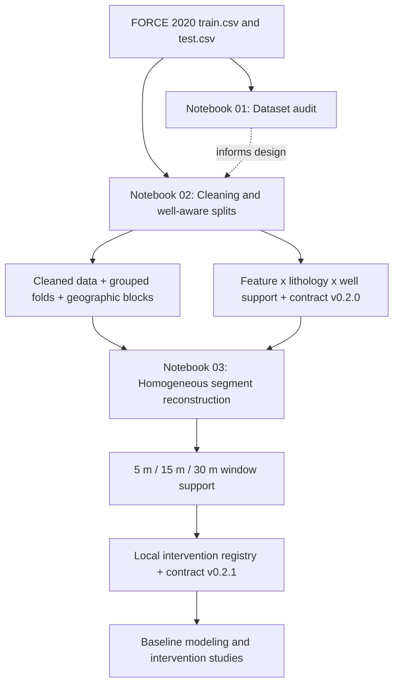

# FORCE 2020: Well-Aware Data Preparation and Intervention Readiness

[](https://www.python.org/)
[](https://jupyter.org/)


**A reproducible, well-aware data preparation workflow for the FORCE 2020 lithology dataset, designed for leakage-aware cross-well evaluation and for identifying where controlled, depth-localized interventions on well logs are feasible.**

This repository covers **data auditing, conservative cleaning, well-aware validation splits, and intervention-support analysis**. Its outputs form the foundation of the modeling and intervention studies in the companion repositories.

## Contents

- [1. Motivation](#1-motivation)
- [2. Dataset](#2-dataset)
- [3. Pipeline](#3-pipeline)
- [4. Notebooks](#4-notebooks)
- [5. Key results](#5-key-results)
- [6. Repository structure](#6-repository-structure)
- [7. Getting started](#7-getting-started)
- [8. Outputs](#8-outputs)
- [9. Design principles](#9-design-principles)
- [10. Downstream projects](#10-downstream-projects)
- [11. Data and attribution](#11-data-and-attribution)

## 1. Motivation

Well-log data are measured repeatedly along the depth of each well. Neighboring rows are highly correlated, lithology classes are unevenly distributed across wells, and individual logs have uneven coverage. As a result, a large number of rows does not automatically mean strong, independent support for model evaluation or for lithology-specific analyses.

This preparation stage answers four questions:

1. **Data integrity:** What is the quality, coverage, depth continuity, and class distribution of the data?
2. **Generalization:** How should validation folds be built so that no well appears in both training and evaluation?
3. **Support:** Which feature–lithology combinations are represented across enough distinct wells and folds?
4. **Intervention feasibility:** For depth-localized changes of **5 m, 15 m, or 30 m** to a log, where do observed, single-lithology, continuous depth segments exist?

The result is an **experimental-design and feasibility registry** that defines which measurement-level interventions can be studied reliably in later stages.

## 2. Dataset

The study uses the **FORCE 2020 Machine Learning Competition** lithology dataset, which includes well logs, well identifiers, measured depth, lithology labels, and well coordinates.

| Property | Training set | Test set |
|---|---:|---:|
| Rows | 1,170,511 | 122,397 |
| Columns | 29 | 29 |
| Wells | 98 | 10 |
| Shared wells between sets | – | 0 |

### Lithology classes

| Code | Lithology | Code | Lithology |
|---:|---|---:|---|
| 30000 | Sandstone | 65000 | Shale |
| 65030 | Sandstone/Shale | 70000 | Limestone |
| 70032 | Chalk | 74000 | Dolomite |
| 80000 | Marl | 86000 | Anhydrite |
| 88000 | Halite | 90000 | Coal |
| 93000 | Basement | 99000 | Tuff |

### Feature roles

| Role | Logs | Use in the study |
|---|---|---|
| Primary logs | `GR`, `NPHI`, `RHOB`, `PEF`, `DTC`, `SP` | Main candidates for measurement-level interventions |
| Resistivity | `RDEP` | Additional intervention candidate |
| Borehole condition | `CALI` | Borehole conditions and measurement behavior |
| Secondary logs | `RMED`, `DRHO`, `RSHA`, `BS`, `ROP`, `RXO` | Supplementary analyses |
| Other exploratory logs | `MUDWEIGHT`, `DCAL` | Additional candidates |
| Low-coverage logs | `DTS`, `RMIC`, `ROPA`, `SGR` | Limited, exploratory use |

## 3. Pipeline



**Execution order:**

1. `notebooks/01_FORCE2020_dataset_audit_from_scratch.ipynb`
2. `notebooks/01_FORCE_clean_group_spatial_support_splits.ipynb`
3. `notebooks/01B_FORCE_fix_local_windows_and_lock_contract.ipynb`

The audit notebook runs independently; Notebook 03 builds on the outputs of Notebook 02.

## 4. Notebooks

### 4.1 Notebook 01: Dataset audit

**File:** `01_FORCE2020_dataset_audit_from_scratch.ipynb`

A complete descriptive audit of the raw data before any cleaning or modeling:

- Chunked reading of the train and test files with encoding and delimiter detection
- Dimensions, data types, column consistency, target presence, and train/test well overlap
- Lithology frequency, number of supporting wells, and per-class concentration in the largest wells
- Missingness, sentinel values, non-finite values, unusual ranges, and near-constant columns
- Duplicate rows and repeated well–depth keys
- Depth ordering, gaps, and sampling-step statistics per well
- Train/test distribution comparisons with figures and summary tables

The audit is read-only and leaves the source files unchanged. Outputs are written to `outputs/00_dataset_audit/`.

### 4.2 Notebook 02: Cleaning, support audit, and well-aware splits

**File:** `01_FORCE_clean_group_spatial_support_splits.ipynb`

Builds the cleaned dataset and the between-well structure needed for reliable out-of-well evaluation:

- Standardizes target and confidence column names
- Replaces sentinel values (such as `-999`, `-999.25`, `-9999`), infinities, and invalid extremes with `NaN`
- Resolves duplicate well–depth keys by keeping the row with the most observed logs
- Keeps missing values as missing, with no global imputation, so that later preprocessing can be fitted inside training folds
- Measures how concentrated each lithology is across wells using the **effective number of wells**:

  $$N_{\mathrm{eff}} = \frac{1}{\sum_w p_w^2}, \qquad p_w = \frac{n_w}{\sum_j n_j},$$

  where $n_w$ is the number of rows of a lithology in well $w$.

- Computes support at **feature × lithology × well** resolution
- Builds **five well-disjoint grouped folds** with a class-balance-aware assignment
- Builds **five geographic blocks** by K-means clustering of well-level coordinates
- Produces an initial support registry and the design **contract v0.2.0**

Main output: `outputs/01_clean_splits_support/FORCE_train_cleaned_with_splits.parquet`.

### 4.3 Notebook 03: Homogeneous depth segments and feasibility registry

**File:** `01B_FORCE_fix_local_windows_and_lock_contract.ipynb`

Refines segment construction so that every segment is **observed, single-lithology, and depth-continuous**. Each feature-specific segment is split at:

- a missing observation,
- a change in lithology,
- an invalid or non-increasing depth,
- a depth gap larger than a well-specific threshold:

$$G_w = \max\left(3\Delta_w,\ 0.5\ \mathrm{m}\right),$$

where $\Delta_w$ is the median depth step of well $w$.

For each intervention length $d \in \{5, 15, 30\}$ m, the notebook estimates overlapping and non-overlapping window counts, aggregates them by feature, lithology, well, length, and fold, and assigns a support tier:

| Criterion | Primary support | Targeted support |
|---|---:|---:|
| Non-overlapping windows | ≥ 100 | ≥ 30 |
| Supporting wells | ≥ 10 | ≥ 5 |
| Wells with at least 3 windows | ≥ 5 | – |
| Folds with windows | 5 | ≥ 4 |

It then combines window-level support with the feature–lithology registry and writes the final design **contract v0.2.1**.

Main outputs:

- `outputs/01B_fixed_local_windows/01_homogeneous_observed_segments.parquet`
- `outputs/01B_fixed_local_windows/04_window_support_summary.csv`
- `outputs/01B_fixed_local_windows/05_local_intervention_registry.csv`
- `outputs/01B_fixed_local_windows/07_causal_project_contract_v0_2_1.json`

## 5. Key results

### 5.1 Summary

| Measure | Value |
|---|---:|
| Training rows | 1,170,511 |
| Training wells | 98 |
| Lithology classes | 12 |
| Well-disjoint grouped folds | 5 |
| Geographic blocks | 5 |
| Homogeneous observed segments | **227,872** |
| Intervention lengths | **5 m, 15 m, 30 m** |
| Feature–lithology–length combinations assessed | 249 |
| Combinations with primary support | 88 |
| Combinations with targeted support | 39 |
| Feature–lithology pairs supported **at all three lengths** | **14** |
| Pairs supported at specific lengths | 41 |
| Final design contract | **v0.2.1** |

### 5.2 Support by intervention length

| Window length | Primary support | Targeted support | Descriptive |
|---|---:|---:|---:|
| 5 m | 42 | 6 | 35 |
| 15 m | 32 | 14 | 37 |
| 30 m | 14 | 19 | 50 |
| **Total** | **88** | **39** | **122** |

Longer homogeneous intervals are naturally less common, so support decreases as the window length grows.

### 5.3 Feature–lithology pairs supported at all lengths

| Lithology | Features |
|---|---|
| Shale | `DTC`, `GR`, `NPHI`, `PEF`, `RDEP`, `RHOB`, `SP` |
| Sandstone | `DTC`, `GR`, `RDEP`, `RHOB`, `SP` |
| Sandstone/Shale | `GR`, `RDEP` |

These 14 pairs have the strongest data support for intervention studies across all three window lengths.

### 5.4 Rare lithologies

Some classes appear in very few wells, for example Basement (1 well), Halite (3 wells), and Anhydrite (6 wells). The support registry identifies these classes explicitly, so that analyses involving them can be designed and interpreted accordingly.

## 6. Repository structure

```text
FORCE2020-Intervention-Readiness/
├── README.md
├── requirements.txt
├── .gitignore
├── data/
│   └── raw/
│       ├── train.csv
│       └── test.csv
├── notebooks/
│   ├── 01_FORCE2020_dataset_audit_from_scratch.ipynb
│   ├── 01_FORCE_clean_group_spatial_support_splits.ipynb
│   └── 01B_FORCE_fix_local_windows_and_lock_contract.ipynb
├── scripts/
│   └── pre_publish_check.py
└── outputs/                     # created when the notebooks run
    ├── 00_dataset_audit/
    ├── 01_clean_splits_support/
    └── 01B_fixed_local_windows/
```

Data files and generated outputs are kept local and are not tracked by Git.

## 7. Getting started

### 7.1 Requirements

- Python 3 and Jupyter
- Enough memory and disk space for the 1.17-million-row training file
- Packages in `requirements.txt` (`numpy`, `pandas`, `matplotlib`, `scikit-learn`, `pyarrow`, and Jupyter)

### 7.2 Data

Download the FORCE 2020 competition data from the [official competition repository](https://github.com/bolgebrygg/Force-2020-Machine-Learning-competition) or the [Zenodo record](https://doi.org/10.5281/zenodo.4351156), and place the CSV files at:

```text
data/raw/train.csv
data/raw/test.csv
```

### 7.3 Setup

```bash
cd FORCE2020-Intervention-Readiness
python3 -m venv .venv
source .venv/bin/activate
python -m pip install --upgrade pip
python -m pip install -r requirements.txt
python -m jupyter lab
```

The notebooks resolve paths relative to the repository root:

```python
from pathlib import Path

REPO_ROOT = Path.cwd().resolve()
DATA_DIR = REPO_ROOT / "data" / "raw"
RESULTS_ROOT = REPO_ROOT / "outputs"
```

### 7.4 Run order

1. Run `01_FORCE2020_dataset_audit_from_scratch.ipynb`.
2. Run `01_FORCE_clean_group_spatial_support_splits.ipynb`, which creates the cleaned Parquet file, the support registry, and contract v0.2.0.
3. Run `01B_FORCE_fix_local_windows_and_lock_contract.ipynb`, which creates the local intervention registry and contract v0.2.1.

**Troubleshooting**

- `FileNotFoundError` for the CSV files: check the file names and `DATA_DIR`.
- `FileNotFoundError` in Notebook 03: run Notebook 02 first.
- `ModuleNotFoundError`: activate the virtual environment and reinstall `requirements.txt`.
- Wrong interpreter in Jupyter: select the `.venv` kernel.

## 8. Outputs

| Stage | Output | Purpose |
|---|---|---|
| Audit | Per-class and per-well summaries, missingness and depth diagnostics | Data transparency |
| Cleaning and splits | `FORCE_train_cleaned_with_splits.parquet` | Cleaned data with fold and block assignments |
| Cleaning and splits | `10_grouped_5fold_well_assignment.csv` | Well-disjoint validation folds |
| Cleaning and splits | `14_geographic_well_blocks.csv` | Spatial grouping of wells |
| Cleaning and splits | `19_final_treatment_registry.csv` | Feature–lithology support registry |
| Cleaning and splits | `20_causal_project_contract_v0_2.json` | Initial design contract |
| Window analysis | `01_homogeneous_observed_segments.parquet` | Homogeneous, continuous segments |
| Window analysis | `04_window_support_summary.csv` | Support by feature, class, and length |
| Window analysis | `05_local_intervention_registry.csv` | Final support tiers |
| Window analysis | `07_causal_project_contract_v0_2_1.json` | Final design contract |

The design contract is a **machine-readable record** of the study scope, feature roles, and support eligibility, used directly by the downstream projects.

## 9. Design principles

1. **Well-disjoint validation:** folds are split by well, never by individual rows.
2. **Spatial grouping:** coordinate-based geographic blocks enable spatial stress testing.
3. **Class-aware support:** class coverage is tracked per well and per fold, including rare lithologies.
4. **No premature preprocessing:** missing values are kept as is, so imputation and scaling can later be fitted inside training folds.
5. **Feasibility before experimentation:** intervention candidates are screened for data support before any modeling.
6. **Test set kept separate:** the test file is used only for descriptive auditing, not for design decisions.
7. **Machine-readable contracts:** every design decision is recorded in versioned JSON contracts.

## 10. Downstream projects

The folds, cleaned data, and design contract produced here are used in:

- [FORCE2020-Lithology-Benchmarks-and-Calibration](https://github.com/Mohaddesemoghaddam/FORCE2020-Lithology-Benchmarks-and-Calibration): baseline reproduction, well-grouped evaluation, and nested calibration
- [StrataShift](https://github.com/Mohaddesemoghaddam/StrataShift): controlled measurement interventions and model robustness
- [StrataWeave](https://github.com/Mohaddesemoghaddam/StrataWeave): geo-stratigraphic and temporal model fusion

## 11. Data and attribution

Well-log measurements are released under the **Norwegian Licence for Open Government Data (NLOD) 2.0** and lithology labels under **CC BY 4.0**; see the [official competition rules](https://thinkonward.com/app/c/challenges/force-well-logs/rules).

> Lithofacies data was provided by the FORCE Machine Learning competition with well logs and seismic 2020.

Bormann, P., Aursand, P., Dilib, F., Dischington, P., & Manral, S. (2020). *2020 FORCE Machine Learning Contest*. [Competition repository](https://github.com/bolgebrygg/Force-2020-Machine-Learning-competition).

Dataset record: [FORCE 2020 Well log and lithofacies dataset for machine learning competition](https://doi.org/10.5281/zenodo.4351156).

**Author:** Mohaddese Moghaddam
