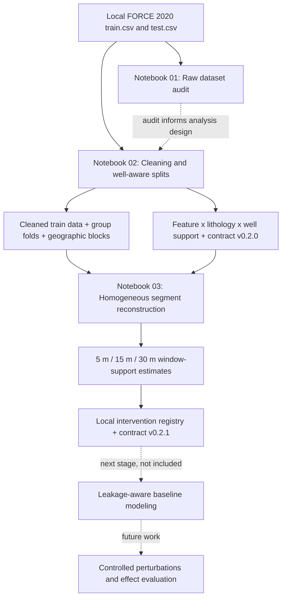

# FORCE 2020: Well-Aware Data Preparation and Intervention Readiness

[](https://www.python.org/)
[](https://jupyter.org/)


**A reproducible, well-aware preparation workflow for the FORCE 2020 lithology dataset, designed to support leakage-aware cross-well evaluation and feasibility screening for controlled, depth-localized interventions.**

> **Research scope:** This repository contains **data auditing, conservative cleaning, well-aware validation splitting, and intervention-support diagnostics**. It **does not** train a predictive model, implement a treatment/intervention, estimate an average treatment effect (ATE) or conditional average treatment effect (CATE), or establish causal identification. Terms such as *confirmatory support* refer only to predefined **data-support eligibility rules**.

## Contents

- [1. Research motivation](#1-research-motivation)
- [2. Dataset and terminology](#2-dataset-and-terminology)
- [3. Processing pipeline](#3-processing-pipeline)
- [4. Notebook-by-notebook methodology](#4-notebook-by-notebook-methodology)
- [5. Recorded data diagnostics and support results](#5-recorded-data-diagnostics-and-support-results)
- [6. Repository structure](#6-repository-structure)
- [7. Installation and reproducible execution](#7-installation-and-reproducible-execution)
- [8. Outputs and interpretation](#8-outputs-and-interpretation)
- [9. Methodological safeguards and limitations](#9-methodological-safeguards-and-limitations)
- [10. Planned next stage](#10-planned-next-stage)
- [11. Data provenance, licensing and citation](#11-data-provenance-licensing-and-citation)

## 1. Research motivation

Well-log records consist of measurements collected repeatedly along the depth axis of each well. Neighboring rows are highly dependent; lithology classes are not uniformly distributed across wells; and individual logging curves have uneven availability. Consequently, **a large number of rows does not imply independent experimental support** for model evaluation, local interventions, or lithology-specific comparisons.

The preparation stage addresses four questions:

1. **Data integrity:** What is the quality, availability, depth continuity, and class distribution of the provided data?
2. **Generalization:** How can model validation avoid placing rows from the same well in training and evaluation partitions?
3. **Support:** Which feature–lithology combinations are represented across sufficiently many distinct wells and validation folds?
4. **Intervention feasibility:** For a proposed **5 m, 15 m, or 30 m** depth-localized change to a logging curve, where do observed, single-lithology, depth-contiguous segments exist?

The output is an **experimental-design and feasibility registry**, not a causal-effect estimate. The intended *future* estimand concerns the effect of a controlled **measurement-level perturbation** on a model's predictions or errors. It is **not** a claim that modifying a measured logging curve changes the physical lithology of a rock formation.

## 2. Dataset and terminology

### Dataset

The study uses the **FORCE 2020 Machine Learning Competition** lithology prediction dataset, which includes measured well logs, well identifiers, measured depth, lithology annotations, and well-location coordinates. The train/test CSV files used in the archived notebook runs were:

| Property | Training partition | Supplied test partition |
|---|---:|---:|
| Rows | 1,170,511 | 122,397 |
| Columns | 29 | 29 |
| Wells | 98 | 10 |
| Lithology labels present in the supplied file | Yes | Yes |
| Well identifiers shared across partitions | \- | **0** |

**Important:** The counts above describe the **particular CSV inputs used in the recorded runs**, not necessarily every redistributed or reformatted FORCE 2020 release. Raw data are not committed to this repository. The supplied test file was inspected descriptively but is not a source for fitting preprocessing choices or selecting future models.

### Lithology labels

The audited training file contains **12** lithology categories:

| Code | Lithology | Code | Lithology |
|---:|---|---:|---|
| 30000 | Sandstone | 65000 | Shale |
| 65030 | Sandstone/Shale | 70000 | Limestone |
| 70032 | Chalk | 74000 | Dolomite |
| 80000 | Marl | 86000 | Anhydrite |
| 88000 | Halite | 90000 | Coal |
| 93000 | Basement | 99000 | Tuff |

### Features and roles

The preparation notebook defines the following roles for its **proposed future analysis**:

| Role | Logging features | Interpretation |
|---|---|---|
| Primary logging features | `GR`, `NPHI`, `RHOB`, `PEF`, `DTC`, `SP` | Primary measurement-level perturbation candidates |
| Resistivity extension | `RDEP` | Additional resistivity-based intervention candidate |
| Pathway-oriented feature | `CALI` | Intended investigation of borehole conditions and measurement behavior |
| Selected secondary features | `RMED`, `DRHO`, `RSHA`, `BS`, `ROP`, `RXO` | Supplementary or exploratory analyses |
| Other exploratory features | `MUDWEIGHT`, `DCAL` | Additional candidates defined in the notebook |
| Low-coverage features | `DTS`, `RMIC`, `ROPA`, `SGR` | Interpret cautiously due to limited observed support |

Feature-role labels describe the **study design** and do not, by themselves, demonstrate the existence or direction of causal pathways.

## 3. Processing pipeline



**Execution order:**

1. `notebooks/01_FORCE2020_dataset_audit_from_scratch.ipynb`
2. `notebooks/01_FORCE_clean_group_spatial_support_splits.ipynb`
3. `notebooks/01B_FORCE_fix_local_windows_and_lock_contract.ipynb`

The audit is a **descriptive, standalone** notebook. Notebook 3 **requires artifacts created by Notebook 2**. Their filenames are historical; the numbered list above is the actual execution order.

## 4. Notebook-by-notebook methodology

### 4.1 Notebook 01 — Raw data audit

**File:** `01_FORCE2020_dataset_audit_from_scratch.ipynb`

**Purpose:** Examine the original input files *before* cleaning and model training.

Key operations:

- Read the train/test CSV files with basic encoding and delimiter detection, using chunked reads.
- Check row/column dimensions, data types, common and differing columns, target presence, and train/test well overlap.
- Summarize lithology frequency, number of supporting wells, and per-class concentration in the largest contributing wells.
- Audit missingness, candidate sentinel values, non-finite values, unusual numeric ranges, and constant or near-constant columns.
- Inspect complete-row duplicates and repeated `WELL`–`DEPTH_MD` keys.
- Audit measured-depth ordering, missing depths, repeated depths, and sampling-step statistics per well.
- Compare selected train/test descriptive distributions and generate exploratory figures and tables.

**What it does not do:** It does **not** resample, impute, standardize, fit models, or overwrite source files.

**Output directory after path configuration:** `outputs/00_dataset_audit/` (generated locally, not committed).

### 4.2 Notebook 02 — Conservative cleaning, support audit, and leakage-aware splits

**File:** `01_FORCE_clean_group_spatial_support_splits.ipynb`

**Purpose:** Build a cleaned dataset and establish the *between-well* support needed for credible out-of-well evaluation and later intervention analyses.

Key operations:

- Standardize long target/confidence names to `target` and `confidence`.
- Replace recognized sentinel values (e.g. `-999`, `-999.25`, `-9999`, `-99999`), infinities, and extreme invalid numeric values with `NaN`.
- Detect full duplicates and duplicate well–depth keys; prioritize rows with more observed logs if duplicate well–depth keys occur.
- Retain missing values rather than applying global imputation. Sort by well/depth and assign a row identifier.
- Summarize concentration of each lithology across wells, including the **effective number of wells**:

  $$N_{\mathrm{eff}} = \frac{1}{\sum_w p_w^2}, \qquad p_w = \frac{n_w}{\sum_j n_j},$$

  where $n_w$ is the number of rows belonging to a given lithology in well $w$. This is a concentration-adjusted well count—not a statistical sample-size or power guarantee.

- Calculate observed support at **feature × lithology × well** resolution, including counts, well coverage, and between-well concentration.
- Generate initial depth-contiguous, observed-feature runs and preliminary approximate window counts for 5 m, 15 m, and 30 m.
- Construct **5 well-disjoint grouped folds**, using a class-balance-aware assignment procedure (not ordinary random row splitting).
- Generate **5 geographic blocks** by K-means clustering standardized well-level median `X_LOC`/`Y_LOC` coordinates.
- Summarize feature–class support across folds and blocks, producing an initial treatment-support registry and **contract v0.2.0**.

**Corrected downstream:** This notebook's initial homogeneous-window screen treated complete observed runs as homogeneous only when they contained a single lithology. Shorter usable subsegments could therefore be excluded. Notebook 03 fixes that segment-construction logic.

**Representative artifact:** `outputs/01_clean_splits_support/FORCE_train_cleaned_with_splits.parquet`.

### 4.3 Notebook 03 — Homogeneous depth segments and final feasibility registry

**File:** `01B_FORCE_fix_local_windows_and_lock_contract.ipynb`

**Purpose:** Correctly split observed intervals at lithology boundaries before assessing local intervention support.

Each feature-specific segment is broken at:

- a missing feature observation;
- a change in lithology class;
- an invalid/non-increasing measured depth;
- a depth gap larger than the prescribed threshold.

The gap threshold is defined at well level as:

$$G_w = \max\left(3\Delta_w,\ 0.5\ \mathrm{m}\right),$$

where $\Delta_w$ is the median positive measured-depth step for well $w$.

Each retained segment is therefore intended to be **observed, single-lithology, and approximately depth-contiguous**. For each candidate intervention depth $d \in \{5,15,30\}$ m, the notebook derives approximate **overlapping start counts** and **non-overlapping window capacities**; aggregates these by feature, lithology, well, dose, and grouped fold; and assigns data-support tiers.

The recorded local-CATE screening thresholds are:

| Support criterion | Primary local CATE eligibility | Targeted local CATE eligibility |
|---|---:|---:|
| Estimated non-overlapping windows | ≥ 100 | ≥ 30 |
| Supporting wells | ≥ 10 | ≥ 5 |
| Wells with at least 3 windows | ≥ 5 | Not separately required |
| Grouped folds with windows | 5 | ≥ 4 |

The notebook then reconciles local-window support with the preliminary feature–lithology registry and writes the updated **contract v0.2.1**.

**Representative artifacts:**

- `outputs/01B_fixed_local_windows/01_homogeneous_observed_segments.parquet`
- `outputs/01B_fixed_local_windows/04_window_support_summary.csv`
- `outputs/01B_fixed_local_windows/05_local_intervention_registry.csv`
- `outputs/01B_fixed_local_windows/07_causal_project_contract_v0_2_1.json`

## 5. Recorded data diagnostics and support results

> **Provenance of these numbers:** These are *recorded outputs* in the three original executed notebooks. The notebooks have **not** been rerun as part of preparing this repository; results may differ with another CSV release, dependency version, or code modification.

### 5.1 Summary

| Measure | Recorded value |
|---|---:|
| Training rows, before and after conservative cleaning | 1,170,511 |
| Training wells | 98 |
| Lithology classes | 12 |
| Grouped folds (well-disjoint) | 5 |
| Geographic blocks | 5 |
| Preliminary observed continuous runs | 2,375 |
| Reconstructed homogeneous observed segments | **227,872** |
| Local candidate depths | **5 m, 15 m, 30 m** |
| Feature–lithology–dose combinations assessed | 249 |
| Primary local-CATE support combinations | 88 |
| Targeted local-CATE support combinations | 39 |
| Descriptive/insufficient local combinations | 122 |
| Feature–lithology pairs eligible for confirmatory support **at all three doses** | **14** |
| Pairs eligible only for dose-specific/targeted follow-up | 41 |
| Descriptive-only pairs (final tier) | 40 |
| Final experimental-design contract | **v0.2.1** |

### 5.2 Why the three-dose restriction matters

The 249 feature–lithology–dose combinations break down as:

| Depth window | Primary support | Targeted support | Insufficient / descriptive |
|---|---:|---:|---:|
| 5 m | 42 | 6 | 35 |
| 15 m | 32 | 14 | 37 |
| 30 m | 14 | 19 | 50 |
| **Total** | **88** | **39** | **122** |

Longer continuous, lithology-homogeneous intervals are less common; consequently, **support for 30 m windows is more restrictive than support for 5 m windows**.

### 5.3 All-dose confirmatory-support feature–lithology pairs

The **14** pairs meeting the pipeline's final all-dose support designation are:

| Lithology | Features |
|---|---|
| Shale | `DTC`, `GR`, `NPHI`, `PEF`, `RDEP`, `RHOB`, `SP` |
| Sandstone | `DTC`, `GR`, `RDEP`, `RHOB`, `SP` |
| Sandstone/Shale | `GR`, `RDEP` |

**Interpretation:** These combinations pass the specified *data support and coverage gates*. They are **not** combinations for which statistically significant causal effects have been demonstrated.

### 5.4 Support for rare lithologies

Some classes are represented in very few distinct wells. The recorded training set includes, for example, Basement in only **one** well; Halite in **three** wells; and Anhydrite in **six** wells. These classes cannot support the same level of independent cross-well analysis as widespread classes such as Shale or Sandstone. Their future results should be clearly labeled exploratory or descriptive as appropriate.

## 6. Repository structure

```text
FORCE2020-Intervention-Readiness/
├── README.md
├── requirements.txt
├── .gitignore
├── data/
│   └── raw/
│       ├── train.csv                    # local only; ignored by Git
│       └── test.csv                     # local only; ignored by Git
├── notebooks/
│   ├── 01_FORCE2020_dataset_audit_from_scratch.ipynb
│   ├── 01_FORCE_clean_group_spatial_support_splits.ipynb
│   └── 01B_FORCE_fix_local_windows_and_lock_contract.ipynb
├── scripts/
│   └── pre_publish_check.py
└── outputs/                          # created on execution; ignored by Git
    ├── 00_dataset_audit/
    ├── 01_clean_splits_support/
    └── 01B_fixed_local_windows/
```

**Committed to GitHub:** notebooks **without saved cell outputs**, this README, a dependency list, `.gitignore`, and the lightweight pre-publication check.

**Not committed:** FORCE raw CSVs, intermediate/final Parquet and CSV artifacts, contract JSON results, plots, temporary files, virtual environments, or embedded notebook execution outputs.

## 7. Installation and reproducible execution

### 7.1 Requirements

- Python 3.x, Jupyter, and sufficient local RAM/disk for the approximately 1.17-million-row training file.
- Raw `train.csv` and `test.csv` files **matching the expected FORCE competition schema**.
- Python packages listed in `requirements.txt` (`numpy`, `pandas`, `matplotlib`, `scikit-learn`, `pyarrow`, and Jupyter utilities).

The notebooks as originally developed contain a small **auto-install-missing-dependencies** cell. For repeatable execution, install packages explicitly before opening Jupyter instead. The dependency list is intentionally not a precise lockfile; for a publication-quality rerun, record the exact interpreter and package versions used.

### 7.2 Get the source data

Obtain the relevant FORCE 2020 competition inputs from their authorized distribution and place the **CSV files expected by these notebooks** at:

```text
data/raw/train.csv
data/raw/test.csv
```

The [FORCE competition archive](https://github.com/bolgebrygg/Force-2020-Machine-Learning-competition) and [Zenodo record](https://doi.org/10.5281/zenodo.4351156) provide official context and downloadable materials. **A dataset archive may distribute LAS files rather than exactly the two CSV files used here; verify file format and column names instead of assuming the files are interchangeable.**

### 7.3 Set up Python on macOS/Linux

```bash
cd FORCE2020-Intervention-Readiness
python3 -m venv .venv
source .venv/bin/activate
python -m pip install --upgrade pip
python -m pip install -r requirements.txt
```

To start Jupyter:

```bash
python -m jupyter lab
```

### 7.4 Check the path configuration

The **publication-ready versions** of the notebooks should resolve paths relative to the repository root:

```python
from pathlib import Path

# When launching Jupyter from the repository root:
REPO_ROOT = Path.cwd().resolve()
DATA_DIR = REPO_ROOT / "data" / "raw"
RESULTS_ROOT = REPO_ROOT / "outputs"
```

If launching a notebook from `notebooks/` instead, adapt `REPO_ROOT` accordingly, or set an explicit project-root environment variable as implemented in your path-corrected notebooks. **The code block is an example, not a claim that all versions automatically detect every launch directory.** Confirm your saved path edits before running.

### 7.5 Run in order

- **First:** Run all cells in `01_FORCE2020_dataset_audit_from_scratch.ipynb`.
- **Second:** Run all cells in `01_FORCE_clean_group_spatial_support_splits.ipynb` and confirm that the cleaned Parquet, registry and `v0.2.0` contract exist.
- **Third:** Run all cells in `01B_FORCE_fix_local_windows_and_lock_contract.ipynb`; this stage reads the previous stage's outputs and writes the corrected local support registry and `v0.2.1` contract.

Useful local verification commands:

```bash
python scripts/pre_publish_check.py
# Verify included files just before committing:
git status --short
```

**Troubleshooting:**

- `FileNotFoundError` for `train.csv` or `test.csv`: check file names, CSV format, and `DATA_DIR`.
- `FileNotFoundError` in Notebook 03: execute Notebook 02 first and inspect its `OUTPUT_DIR`.
- `ModuleNotFoundError`: activate the project's virtual environment and reinstall `requirements.txt`.
- Jupyter uses the wrong interpreter: select the kernel associated with `.venv`.
- Git detects notebook output changes after running: clear outputs before committing or run the provided publication check.

## 8. Outputs and interpretation

Each notebook generates **local reproducibility artifacts**, but output data are intentionally absent from the GitHub repository. Representative stage-specific files include:

| Stage | Representative output | Why it matters |
|---|---|---|
| Audit | per-class and per-well summaries, missingness and depth diagnostics | Raw-data transparency |
| Cleaning/splits | `FORCE_train_cleaned_with_splits.parquet` | Cleaned measurements plus fold/block assignments |
| Cleaning/splits | `10_grouped_5fold_well_assignment.csv` | Well-disjoint validation grouping |
| Cleaning/splits | `14_geographic_well_blocks.csv` | Spatially grouped analysis |
| Cleaning/splits | `19_final_treatment_registry.csv` | Preliminary feature–lithology support eligibility |
| Cleaning/splits | `20_causal_project_contract_v0_2.json` | Initial design contract |
| Window revision | `01_homogeneous_observed_segments.parquet` | Homogeneous, observed, depth-contiguous subsegments |
| Window revision | `04_window_support_summary.csv` | Feature/class/dose coverage summary |
| Window revision | `05_local_intervention_registry.csv` | Final local support tiers |
| Window revision | `07_causal_project_contract_v0_2_1.json` | Updated design contract |

The design contract is a **machine-readable record of the intended research scope and support eligibility**, not evidence of a completed experiment.

## 9. Methodological safeguards and limitations

1. **No row-level leakage across grouped folds.** Training and validation groups must be split by `WELL`, not randomly by measurement row. Different wells may still be similar geologically; well-disjoint splitting is not a universal guarantee of independent observations.
2. **Geographic blocks are approximations.** Coordinate-based K-means groups are useful for spatial stress testing, but are not the same as geologically defined formations or verified stratigraphic boundaries.
3. **Uneven class support.** Some lithologies are concentrated in one or a few wells and may be missing from individual folds. Class-wise evaluation must track the denominator and whether each class is present.
4. **Missing measurements remain missing.** Do not fit a global imputer or scaler before splitting. Future imputers, scalers, selectors, and learned preprocessing must be fit **inside training folds only**.
5. **Window capacity is approximate.** Counting candidate windows from median depth steps and segment lengths is a *feasibility proxy*. Each actual intervention must recheck observed sample depths, edge coverage, homogeneity, and overlap/independence.
6. **Descriptive test-file inspection is not model selection.** Even though the supplied test file was descriptively audited, future model and perturbation hyperparameters must be decided using training/validation data—not by repeatedly optimizing on the test set.
7. **No causal identification yet.** Eligibility tiers do not establish exchangeability, consistency, positivity for a causal estimand, absence of unmeasured confounding, or an independently estimated causal effect.
8. **Correlated windows.** Even nominally non-overlapping intervals from the same well need not be independent. Well-aware uncertainty estimation remains necessary in downstream analyses.
9. **Version dependence.** Exact counts may differ when CSV variants, library versions, upstream preprocessing, or any eligibility thresholds change.
10. **Reproduction requires raw inputs.** The code is published, but the repository intentionally does not contain the datasets or generated result files.

## 10. Planned next stage

The final contract records `baseline_ready: true` and identifies `02_FORCE_baseline_models_grouped_cv` as the intended next step. A future modeling stage may compare **logs-only**, **domain-graph**, **full-spatial**, and **context-only** feature configurations, subject to a separately documented prediction protocol.

Before estimating any perturbation-related effect, future work should additionally:

- define the treatment/perturbation and response metric explicitly;
- implement exact window extraction and verification rather than relying on approximate support counts;
- fit and evaluate baseline models under leakage-aware grouped validation;
- specify whether the estimand is model sensitivity, prediction change, or an observational causal quantity;
- quantify between-well uncertainty and conduct robustness/sensitivity checks;
- reserve the supplied test split for appropriately limited, pre-specified final evaluation.

**These steps are future work, not results of the present repository.**

## 11. Data provenance, licensing and citation

### Source data

The FORCE competition rules state that the **well-log measurements** are subject to the **Norwegian Licence for Open Government Data (NLOD) 2.0** and the provided **lithology labels** to **CC BY 4.0**. Publishing notebooks does not transfer those licenses to your own code. See the [official competition rules](https://thinkonward.com/app/c/challenges/force-well-logs/rules) for the authoritative terms.

### Required source attribution

> Lithofacies data was provided by the FORCE Machine Learning competition with well logs and seismic 2020.

Source citation recommended by the competition organizers:

Bormann, P., Aursand, P., Dilib, F., Dischington, P., & Manral, S. (2020). *2020 FORCE Machine Learning Contest*. [Competition repository](https://github.com/bolgebrygg/Force-2020-Machine-Learning-competition).

Dataset record: [FORCE 2020 Well log and lithofacies dataset for machine learning competition](https://doi.org/10.5281/zenodo.4351156).

### This repository's code license

**No code license is assumed by this starter template.** The repository owner and any co-authors should explicitly select and add a `LICENSE` file (for example, MIT or Apache-2.0, as appropriate to the actual code ownership and distribution requirements) before inviting downstream reuse. The source dataset's licenses are separate.

---

**Status:** Dataset auditing, well-aware splitting, homogeneous-window support screening, and contract finalization are documented. Baseline training and causal/intervention experiments remain outside this release.
